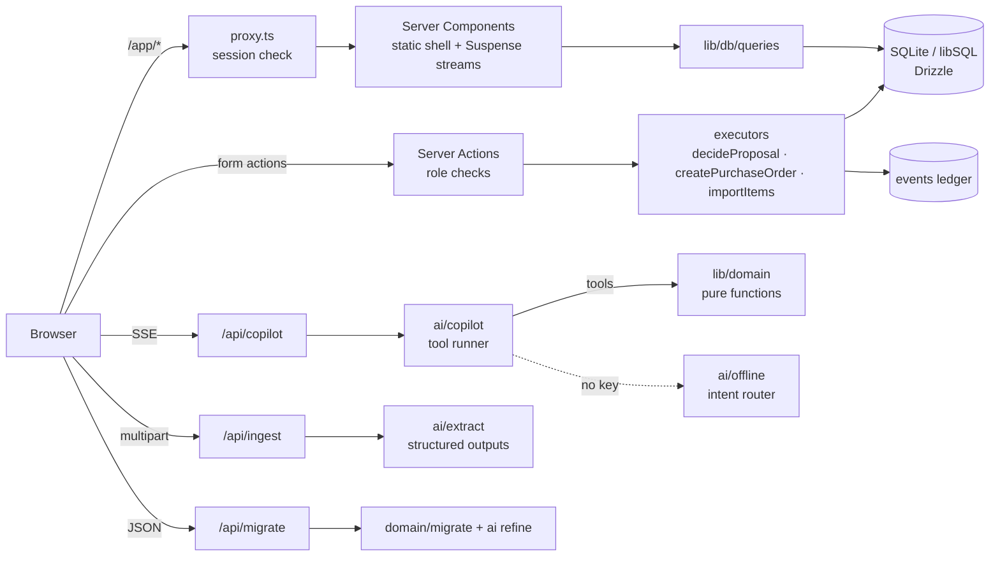

# Architecture

## Request flow

## Layers

| Layer  | Path                        | Rules                                                                                                                                        |
| ------ | --------------------------- | -------------------------------------------------------------------------------------------------------------------------------------------- |
| Domain | `src/lib/domain`            | Pure TypeScript. No framework, DB or network imports. Takes a `Snapshot`, returns data. Unit-tested.                                         |
| Data   | `src/lib/db`                | Drizzle schema, auto-migrating client, read queries (`connection()`-marked, request-time) and write executors that always log to the ledger. |
| AI     | `src/lib/ai`                | The only code that talks to Claude. Every call has an offline path or a graceful error.                                                      |
| Auth   | `src/lib/auth`              | Web Crypto HMAC tokens usable from the proxy and server code; persona and permission matrix.                                                 |
| UI     | `src/app`, `src/components` | Server Components by default; client components only for interaction (chat, workbenches, palette, filters).                                  |

## Data model

`suppliers` ⇄ `items` ⇄ `purchase_orders` / `po_lines` · `customers` ⇄ `sales_orders` / `so_lines` ⇄ `work_orders` · `assets` ·
`proposals` (agent drafts with JSON payloads) · `events` (append-only ledger) · `documents` (ingested, with extraction JSON).
Migrations are generated by drizzle-kit into `drizzle/` and applied automatically on first connection; an empty database is seeded with the
demo plant (dates relative to “now”, so the demo never goes stale).

## Planning math (deterministic)

- **Stock position** = on hand − allocated + inbound on open POs. Threshold = reorder point + half the lead-time demand (capped at 14 days).
  Health: _critical_ when cover is under half the lead time, _low_ when projected stock is below threshold. Finished goods are make-to-order.
- **Capacity forecast:** each station has 14 productive hours/day. A work order waits for every higher-priority (or equal-priority,
  earlier-due) job at its station; blocked jobs get a one-day penalty. Slack = due − forecast finish.
- **Order risk:** a sales order is _late_ if any linked work order has negative slack, _tight_ under one day.
- **Asset risk:** (100 − health)% + service-vs-MTBF and ISO 10816 vibration penalties — every point has a reason string.

## Agents

| Agent         | Finds                                   | Proposes                                                            |
| ------------- | --------------------------------------- | ------------------------------------------------------------------- |
| Reorder       | SKUs under lead-time-adjusted threshold | One PO per supplier, rounded to reorder lots                        |
| Expedite      | Non-blocked work orders forecast late   | Raise to P1                                                         |
| Maintenance   | Assets ≥ 55% failure risk               | 4h preventive window                                                |
| Supplier risk | Suppliers < 80% on-time                 | Re-source SKUs to a reliable supplier already selling that category |

Proposals carry a `dedupeKey`, so re-running agents never duplicates pending work. Approval is claimed atomically
(`UPDATE … WHERE status = 'pending'`) before execution, so double-clicks can't execute twice.

## Claude integration

- `ai/client.ts` — lazily constructs the SDK client only when a key is present; `withFallback()` adds the
  `server-side-fallback-2026-07-01` beta with `fallbacks: "default"`; typed SDK errors are mapped to operator-friendly messages.
- `ai/copilot.ts` — `client.beta.messages.toolRunner({ stream: true, … })` with `betaZodTool` tools (`eager_input_streaming: true`, Zod-validated
  before `run`). Stream events become SSE frames: `tool_start`, `tool_end`, `text`, `proposal`, `done`, `error`. Stops on `refusal` and on
  `max_tokens` mid tool call. The static system prompt is cached.
- `ai/extract.ts` — `client.beta.messages.parse` with `betaZodOutputFormat(ExtractionSchema)` for documents (text, PDF `document` blocks,
  images) and for migration mapping; mapping output is re-validated against the real CSV headers before use.
- `ai/offline.ts` — deterministic router over the same read tools, streamed in the same event format.

## Rendering

Cache Components + Partial Prerendering: every `/app/*` sheet ships a static shell (title block, navigation) instantly and streams live
data behind `<Suspense>` with hatched skeletons. Reads call `connection()` so plant data is never baked into the build.

## Testing

`tests/fixture.ts` builds an in-memory libSQL database, applies the real SQL migrations, seeds the demo plant and returns a snapshot,
so tests exercise the schema, seed and domain logic together. CI runs lint, format check, typecheck, tests and a production build.
